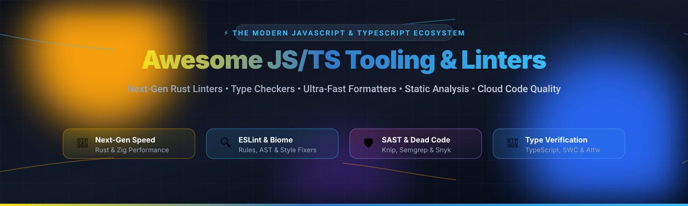

# Awesome JavaScript & TypeScript Tooling & Linters ⚡🔍

  

  
  
  
  
  
  

  <strong>A curated catalogue of high-speed Rust/Zig formatters, industrial-strength JavaScript and TypeScript linters, AST parsers, static analysis security tools (SAST), dead-code analyzers, and cloud code quality platforms.</strong> 🌟 Star if you find it helpful! 🌟

---

## 📑 Table of Contents
- [Sector Overview & Market Dynamics 📊](#sector-overview--market-dynamics-)
- [SaaS / Hosted Platforms ☁️](#saas--hosted-platforms-️)
- [Open-Source Linters, Formatters & Toolchains 🛠️](#open-source-linters-formatters--toolchains-️)
- [Star History 📈](#star-history-)
- [Support & Community 💖](#support--community-)
- [Contributing 🤝](#contributing-)
- [License 📄](#license-)

---

## Sector Overview & Market Dynamics 📊

The global static code analysis and code quality software market is currently valued at approximately **$1.15B to $2.15B** (projected to reach over **$4B to $6B+ by the early 2030s** at an estimated CAGR of **8%–12%**). The sector is **moderately concentrated yet fiercely contested** at the top by enterprise security and inspection incumbents (such as SonarSource, Snyk, Synopsys, and JetBrains), alongside a **highly fragmented long-tail** (accounting for >50% of the market) fueled by rapid developer adoption of open-source Rust toolchains (Oxc, Biome), local AST parsers, and emerging AI-native PR review assistants.

---

## SaaS / Hosted Platforms ☁️

Commercial, cloud-hosted code quality platforms, automated PR review services, and managed continuous inspection suites, sorted in descending order by company valuation/estimated scale.

| Platform | Description | Starting Tier Pricing | Free Tier Limits | Company Scale (Valuation / Revenue) |
| :--- | :--- | :--- | :--- | :--- |
| **[Snyk Code](https://snyk.io)** | Real-time cloud static analysis tool identifying security flaws and code quality issues in JavaScript and TypeScript codebases. | **Team Plan:** $25/contributing developer/month (billed monthly or annually) | **Free forever:** 100 tests/month for Snyk Code (SAST), 200 tests/month for SCA, 300 tests/month for IaC; unlimited scans for public/open-source repos. | **~$7.4B valuation** ($300M+ ARR) |
| **[SonarQube Cloud (SonarCloud)](https://sonarsource.com)** | Enterprise cloud-based code quality and static application security testing (SAST) platform with deep JavaScript/TypeScript rule sets. | **Team Plan:** $34/month (covers up to 100,000 Lines of Code) | **Free forever:** Up to 50,000 Lines of Code (LOC) for private repositories; unlimited LOC for public/open-source projects. | **~$4.7B valuation** (~$175M+ ARR) |
| **[Qodana (JetBrains)](https://jetbrains.com)** | Commercial code quality and static analysis platform bringing WebStorm/IntelliJ JavaScript & TypeScript inspections into CI/CD pipelines. | **Ultimate Plan:** $5.00/contributor/month ($60/contributor/year, min. 3 contributors = $15/month) | **Community Plan (Free forever):** Basic language linters (Java, Python, .NET, C/C++) with unlimited lines of code; excludes JS/TS. **Free Trial:** 60-day full-access free trial for Ultimate/Ultimate Plus (includes full JS/TS inspections). | **~$650M–$700M+ ARR** (Bootstrapped profitable leader, estimated multi-billion valuation) |
| **[CodeClimate Quality (Qlty Software)](https://codeclimate.com)** | Cloud-hosted automated code review service providing maintainability ratings, test coverage, and linter orchestration. | **Pro Tier:** $20/contributor/month | **Free forever:** Unlimited public and private repositories, 1,000 analysis minutes/month, and 100 AI autofixes/month. | **~$200M valuation** (~$12M–$25M ARR) |
| **[Trunk Check / CI (Trunk.io)](https://trunk.io)** | Managed developer experience platform orchestrating hosted linting, formatting, and hermetic toolchain caching across repositories. | **Team Tier:** $18/committer/month | **Free forever:** Up to 5 active committers on private repositories, 1M test spans/committer/month; free for open-source repositories. | **~$100M valuation** ($25M Series A raised) |
| **[Codacy](https://codacy.com)** | Managed DevSecOps platform automating code reviews, ESLint/Biome rule enforcement, code coverage, and technical debt tracking. | **Team Plan:** $18/developer/month (billed annually) or $21/developer/month (billed monthly) | **Developer Plan (Free forever):** IDE/CLI extensions & local quality/security scans for individuals; full Team plan features free for open-source repositories. 14-day free trial on private repos. | **~$32.5M venture funding** (~$7M–$18M ARR) |
| **[DeepSource](https://deepsource.com)** | Automated cloud code health and static analysis platform detecting bugs, anti-patterns, and security vulnerabilities on every pull request. | **Team Plan:** $12/team member/month (billed annually) or $15/month | **Free forever:** Up to 3 private repositories and 3 team members, 3 SCA targets; unlimited public repositories (capped at 1,000 analysis runs and 1,000 formatting runs/month). 14-day free trial. | **~$3M–$10M venture funding** (~$2M–$3M ARR) |

---

## Open-Source Linters, Formatters & Toolchains 🛠️

Free and open-source software (FOSS) linters, ultra-fast Rust/Zig/C++ formatters, static analyzers, dead-code detectors, and TypeScript compilers. Ranked in descending order by GitHub stargazers count:

1. **[TypeScript](https://github.com/microsoft/TypeScript)**  📘
   Microsoft's foundational typed superset of JavaScript that compiles to clean JavaScript with industrial-grade static type analysis and diagnostics.

2. **[Prettier](https://github.com/prettier/prettier)**  💅
   The industry-standard, opinionated code formatter supporting JavaScript, TypeScript, JSX, CSS, HTML, Markdown, and JSON.

3. **[SWC](https://github.com/swc-project/swc)**  ⚡
   Super-fast Rust-based TypeScript/JavaScript compiler, transformer, and minifier powering Next.js, Parcel, and Deno.

4. **[StandardJS](https://github.com/standard/standard)**  📏
   Zero-configuration, opinionated JavaScript style guide, linter, and automatic code fixer built on ESLint.

5. **[ESLint](https://github.com/eslint/eslint)**  🔍
   The foundational, pluggable static analysis and linting engine for JavaScript and TypeScript with the largest community rule ecosystem in the world.

6. **[Biome](https://github.com/biomejs/biome)**  🌳
   Fast, unified Rust-written formatter and linter for JavaScript, TypeScript, JSX, JSON, CSS, and GraphQL (successor to Rome Tools).

7. **[Oxc & Oxlint](https://github.com/oxc-project/oxc)**  🦀
   Suite of high-performance JavaScript and TypeScript tools written in Rust, featuring `oxlint` (50–100x faster than ESLint), parsers, and transformers.

8. **[Rome Tools (Archived Predecessor)](https://github.com/rome/tools)**  🏛️
   Pioneering open-source unified JavaScript/TypeScript toolchain in Rust that laid the architectural foundation for Biome.

9. **[Semgrep](https://github.com/semgrep/semgrep)**  🛡️
   Fast, polyglot static analysis engine for finding vulnerabilities, enforcing secure coding standards, and running custom AST queries across JS/TS repos.

10. **[TypeScript-ESLint](https://github.com/typescript-eslint/typescript-eslint)**  🧩
    The essential tooling and AST parser monorepo enabling ESLint and Prettier to inspect and enforce typed rules in TypeScript codebases.

11. **[Knip](https://github.com/webpro-nl/knip)**  ✂️
    Comprehensive, ultra-fast CLI tool for discovering unused files, dead exports, and orphaned dependencies in JavaScript and TypeScript monorepos.

12. **[SonarQube Community Build](https://github.com/SonarSource/sonarqube)**  🏰
    Open-source self-hosted continuous inspection and code quality server delivering static analysis and security checks for JavaScript and TypeScript.

13. **[Madge](https://github.com/pahen/madge)**  🕸️
    Developer tool for generating visual module dependency graphs, identifying circular dependencies, and inspecting CommonJS/ESM project architecture.

14. **[JSHint](https://github.com/jshint/jshint)**  📜
    Classic, lightweight community static analysis tool detecting errors and potential anti-patterns in JavaScript applications.

15. **[XO](https://github.com/xojs/xo)**  🎯
    Opinionated, zero-config JavaScript and TypeScript linter with strict defaults, enforcing clean syntax and consistency without configuration fatigue.

16. **[dependency-cruiser](https://github.com/sverweij/dependency-cruiser)**  🧭
    Validate and visualize module dependencies in JS/TS projects, enforcing strict architectural boundaries and detecting circular imports.

17. **[eslint-plugin-import](https://github.com/import-js/eslint-plugin-import)**  📦
    Standard ESLint plugin intended to support linting of ES2015+ (ES6+) import/export syntax and prevent file path and export naming issues.

18. **[eslint-plugin-unicorn](https://github.com/sindresorhus/eslint-plugin-unicorn)**  🦄
    More than 100+ powerful, opinionated ESLint rules to enforce modern conventions, eliminate code smells, and write cleaner JavaScript and TypeScript.

19. **[dprint](https://github.com/dprint/dprint)**  🚀
    Pluggable, configurable, ultra-fast code formatting engine written in Rust with WebAssembly plugins for TypeScript, JavaScript, and JSON.

20. **[ts-prune](https://github.com/nadeesha/ts-prune)**  🗑️
    Lightweight CLI utility for finding unused and dead exports across TypeScript codebases.

21. **[ESLint Stylistic](https://github.com/eslint-stylistic/eslint-stylistic)**  🎨
    Community-maintained monorepo for formatting and stylistic rules in ESLint across JavaScript, TypeScript, and JSX.

22. **[Are The Types Wrong? (attw)](https://github.com/arethetypeswrong/arethetypeswrong.github.io)**  ❓
    CLI and web analyzer detecting subtle TypeScript module resolution pitfalls, package export mismatches, and broken `.d.ts` declaration maps.

23. **[Quick-lint-js](https://github.com/quick-lint/quick-lint-js)**  🏎️
    Blazing-fast C++ JavaScript and TypeScript linter finding bugs in real-time with instant editor feedback and zero configuration.

24. **[Deno Lint](https://github.com/denoland/deno_lint)**  🦕
    Rust-powered linter for JavaScript and TypeScript extracted from the Deno runtime for lightning-fast standalone linting.

25. **[Publint](https://github.com/bluwy/publint)**  📮
    Linter for npm packages verifying `package.json` exports, TypeScript declarations, and modern ESM/CJS compatibility.

26. **[prettierd](https://github.com/fsouza/prettierd)**  💨
    Persistent background daemon for Prettier delivering near-instant editor formatting speeds by eliminating Node.js startup overhead.

27. **[tsc-files](https://github.com/gustavopch/tsc-files)**  📁
    Lightweight CLI tool to run `tsc` type checking selectively on git staged files without full monorepo overhead.

---

## Star History 📈

---

## Support & Community 💖

Thank you so much for exploring and using **Awesome JavaScript & TypeScript Tooling & Linters**! 🙌

If you find this curated collection helpful for your projects, workflows, or developer tooling explorations, please consider supporting the project:
* 🌟 **Star the repository** to help others discover it on GitHub.
* 🍴 **Fork the repo** to contribute your own favorite tools, linters, or insights.
* 📢 **Share with your colleagues** and dev community on X / Twitter, LinkedIn, and Discord.
* ☕ **Buy a coffee or sponsor ongoing maintenance:** Visit the [Sponsor Dashboard on GitHub Sponsors](https://github.com/sponsors/ishandutta2007) to help support future maintenance and open-source tooling projects!

---

## Contributing 🤝

Contributions are welcome! Feel free to open a Pull Request to add more open-source JavaScript/TypeScript linters, Rust/Go toolchains, formatters, or static analyzers.

1. Fork the repository.
2. Add your project under the appropriate category with a concise description and correct repository link.
3. Submit a Pull Request.

---

## License 📄

This project is licensed under the [MIT License](LICENSE).
